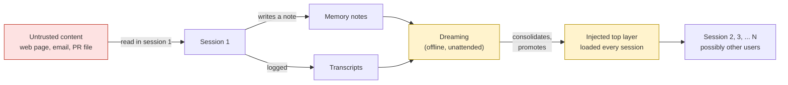

> Anthropic's [*The components of agent memory*](https://www.anthropic.com/research/components-of-agent-memory)
> (Lance Martin, November 6, 2026) is the clearest public account I've read of how agents remember:
> transcripts, memory notes, wikis, and "dreaming," the offline pass that reorganizes it all. The post
> is about making memory *useful*. When it talks about trust, it means errors and drift: a wrong note
> that Claude later believes. This post reads the same architecture as a security engineer would.
> The question isn't only "what if a note is wrong," but "what if someone *made* it wrong, on purpose,
> and it now loads into every session." Everything here is buildable with tools that exist today, and
> I'll say where they fall short.

<!--more-->

## Memory in sixty seconds

The Anthropic post describes a hierarchy, from bottom to top:

1. **Transcripts:** the raw, searchable event log of past sessions.
2. **Memory notes:** facts Claude writes down to use later, usually as files in a folder.
3. **Representations:** structures built from notes and sources, such as a linked wiki Claude maintains.
4. **Injected context:** a small top layer the harness loads into *every* session, so Claude
   "doesn't need to search for them, or even to know there's something to search for."

**Dreaming** is the background process that works across these layers. It reads transcripts and existing
memory, fixes notes that the transcripts contradict, merges duplicates, builds wiki pages, finds patterns
across many sessions, and can "float notes to the top of the memory hierarchy," where the harness
"can preemptively load them into Claude's context at the start of every session."

The post's own warning is the one this whole article builds on:

> "Promoting memories into a new session (a form of context injection) must be done carefully.
> ... an incorrect note can be carried into every session."

### How memory actually reaches the model today

The details matter for security, so here they are for Anthropic's four memory surfaces, from their docs:

| Surface | Where memory lives | How it reaches the model | Controls the docs give you |
|---|---|---|---|
| **Claude Code auto memory** | Your machine: `~/.claude/projects/<project>/memory/` | First 200 lines or 25 KB of `MEMORY.md` loaded **every session**; topic files read on demand | Plain markdown you can edit; disable with `CLAUDE_CODE_DISABLE_AUTO_MEMORY=1` |
| **Claude Code `CLAUDE.md`** | Repo, user home, or org-managed path | Loaded at launch as a user message, not the system prompt | Managed org file users can't exclude; docs say enforce rules with hooks or `permissions.deny`, not memory |
| **Memory tool (API)** | Your application, client-side | Claude is told to view its memory directory before anything else, then reads files through tool calls | You implement storage; docs require path-traversal checks |
| **Managed Agents memory stores** | Anthropic-hosted, scoped to a workspace | Mounted at `/mnt/memory/<slug>/`; a description of each mount goes in the system prompt | `read_only` mounts, immutable versions for 30 days, a redaction endpoint |
| **Managed Agents dreams** | Anthropic-hosted | `POST /v1/dreams` reads one store plus 1–100 session transcripts and writes a **new** output store | Input store never modified; you choose whether to attach the output |

Two things stand out. First, in every surface, memory content ends up as **text in the model's context
with no built-in marker of where it came from**. Second, only one surface's docs warn about the security
problem directly. The Managed Agents memory page says: "a successful prompt injection could write
malicious content into the store. Later sessions then read that content as trusted memory."

## Why memory changes the threat model

Without memory, a prompt injection lasts one session. Memory changes three things.

**Persistence.** Prompt injection becomes *stored* prompt injection. It's the difference between
reflected and stored cross-site scripting: one payload, delivered once, runs for every later visitor.

**Trust laundering.** Text enters as untrusted (a web page, an email, a file in a pull request), gets
written as a "note," and comes back next session looking like the agent's own knowledge. The provenance
gets lost at the write.

**Promotion.** Dreaming adds a step no earlier system had: it can move content *up* the hierarchy,
from a searchable note nobody reads to the always-loaded top layer. For text, that's privilege
escalation. A line that once had to be found by search is now in front of the model on every turn.



This isn't hypothetical. The pattern has been shown repeatedly, and is now seen in the wild:

- **SpAIware (2024).** Johann Rehberger showed that a web page could write instructions into ChatGPT's
  memory. Every later conversation was then sent to an attacker's server.
  [Coverage](https://thehackernews.com/2024/09/chatgpt-macos-flaw-couldve-enabled-long.html).
- **Delayed tool invocation (Gemini, 2025).** A document plants a conditional instruction, roughly "when the
  user next says *yes*, save this memory." The save then runs on the *user's* turn, which gets around the
  rule against calling sensitive tools while processing untrusted data.
  [Write-up](https://embracethered.com/blog/posts/2025/gemini-memory-persistence-prompt-injection/).
- **MINJA (2025).** An attacker with no access to memory, only the ability to send ordinary queries,
  planted records that were later retrieved. The paper reports 98.2% injection success.
  [Paper](https://arxiv.org/abs/2503.03704).
- **AgentPoison (NeurIPS 2024).** A backdoor planted in under 0.1% of a memory or retrieval store
  reached at least 80% attack success with little effect on normal performance.
  [Paper](https://arxiv.org/abs/2407.12784).
- **AI recommendation poisoning (Microsoft, February 2026).** "Summarize with AI" buttons that slip in
  "remember X as a trusted source." Microsoft found more than 50 such prompts from 31 real companies in
  60 days. Memory poisoning has become marketing tooling.
  [Microsoft Security blog](https://www.microsoft.com/en-us/security/blog/2026/02/10/ai-recommendation-poisoning/).

The standards bodies have caught up. OWASP's Top 10 for Agentic Applications lists **Memory & Context
Poisoning (ASI06)**. MITRE ATLAS has **AI Agent Context Poisoning (AML.T0080)**, with a memory
sub-technique.

### What dreaming specifically adds

Reading Anthropic's description with an attacker's eye:

- **It reads many sessions at once.** A dream can take up to 100 transcripts. One poisoned session,
  perhaps one where the agent only *read* a malicious page, becomes an input to consolidated memory.
- **"Check claims against the sources" doesn't help here.** Validating notes against transcripts is a
  good defense against *drift*. Against poisoning, the transcript is where the attacker's text is.
  The check confirms the poison is "in the source."
- **"Find common patterns across sessions" amplifies repetition.** An attacker who can get the same
  instruction into several sessions (a common footer, a shared README) makes it look like a pattern
  worth keeping.
- **It runs offline.** Nobody is watching the dream as it happens. Its output is the most trusted memory
  the agent will have, and the least observed step that produced it.
- **It has a failure mode worth knowing.** Per the docs, a failed or cancelled dream leaves its output
  store "as-is with whatever was written before failure." A half-finished consolidation is a store you
  shouldn't attach.

### Privacy is the other half

Memory accumulates personal data by design. Anthropic's Claude Duet "often benefits from having memories
that are organized around the person it's helping." The privacy problems are familiar to anyone who has
run a data platform, but they're new to most agent teams:

- **Derived data outlives its source.** OpenAI's memory FAQ says deleting a chat doesn't delete memories
  derived from it. A dream's output store is derived from transcripts in the same way. Honoring a deletion
  request means knowing which memories came from which session.
- **Secrets leak into notes.** An agent that saw an API key while debugging may "helpfully" remember it.
- **Retention differs by layer.** Claude Code's transcript cleanup, for example, excludes memory files.
  Managed Agents dreams aren't eligible for zero data retention, and their transcripts persist until you
  delete them.

## A threat model you can hand to engineering

| Threat | Entry point | Impact | Primary control |
|---|---|---|---|
| Stored prompt injection | Agent writes a note after reading untrusted content | Instructions run in every later session | Taint-aware write gate, quarantine |
| Promotion of poisoned content | Dreaming consolidates and promotes | Payload moves to always-loaded context | Review gate on dream output, especially promotions |
| Cross-user contamination | Shared store, or namespace chosen by the model | One user's poison reaches others; data leaks across tenants | Server-enforced namespaces, separate stores by trust level |
| Path traversal in a memory handler | Model-chosen file paths | Reads or writes outside memory: secrets, config | Canonical path checks |
| Secret or PII persistence | Agent remembers what it saw | Data lives indefinitely, then gets injected back into context | Secret and PII scanning on write, TTLs, redaction |
| Silent tampering | Anyone with write access to the store | Behavior changes with no record of why | Versioning, audit log, diffs |
| Unfulfillable deletion | Derived memories, dream outputs | Regulatory exposure | Lineage from memory back to source session |

## How to secure it, stage by stage

The principle behind all of this is **memory is data, never policy.** Anthropic's Claude Code docs say it
directly: memory is "context, not enforced configuration," and a rule that must hold belongs in a hook or
a permission, not in `CLAUDE.md`. If a memory note can grant a capability, you've already lost. Everything
below assumes your real enforcement (tool permissions, egress limits, approvals) lives outside the
model's context, where no note can change it.

Meta's [Agents Rule of Two](https://ai.meta.com/blog/practical-ai-agent-security/) gives a useful frame. An agent
session should combine at most two of: (A) untrusted input, (B) access to sensitive data or systems, (C) the
ability to change state or communicate externally. **A memory write is a state change, and a memory read
can be untrusted input.** That's why memory needs the controls below, and not just the usual ones.

### Stage 1: The write path

This is where you get the most for the least effort, because you own the code that persists a memory.
With the Claude memory tool, you literally implement `create` and `str_replace`. With other frameworks,
wrap their write API.

**1. Track taint at the session level.** Your harness already knows when the agent touched untrusted
content: it ran a web fetch, read an email, opened a file from an external pull request. Set a `tainted`
flag on the session when that happens. In Claude Code, a `PostToolUse` hook on the fetching tools can set it.
This is the single most valuable signal you have, and it doesn't depend on any classifier being right.
It's also the defense Rehberger recommends against delayed tool invocation: once the context holds
untrusted content, sensitive actions (memory writes among them) need confirmation.

**2. Record provenance on every memory.** Store the session ID, the time, the writer (user, agent, dream
job), and the taint flag alongside the content. You'll need this for deletion, incident response and the
read-side labeling below. It costs a few lines of frontmatter.

**3. Scan for secrets and personal data before persisting.** These tools are mature and run in-process:

- Secrets: [detect-secrets](https://github.com/Yelp/detect-secrets) has a Python API that works inline;
  [gitleaks](https://github.com/gitleaks/gitleaks) is fast; [TruffleHog](https://github.com/trufflesecurity/trufflehog)
  can check whether a credential is live. They're tuned for code, so expect misses on secrets paraphrased in prose.
- Personal data: [Microsoft Presidio](https://microsoft.github.io/presidio/) runs locally. Hosted
  alternatives are Google Sensitive Data Protection and AWS Comprehend `DetectPiiEntities`. Presidio's FAQ is
  candid that false positives are inherent; tune the threshold and add recognizers for your domain.

Anthropic's memory tool docs note that Claude "usually refuses" to store sensitive information, and that for
stronger guarantees you should strip it in your handler. "Usually" is the reason this scan exists.

**4. Run a prompt-injection classifier as a tripwire, not a wall.** Two routes:

- **Self-hosted:** [Llama Prompt Guard 2](https://huggingface.co/meta-llama/Llama-Prompt-Guard-2-22M) comes in
  22M- and 86M-parameter versions you run yourself. Its window is 512 tokens, so split long memories into chunks.
- **Commercial prompt-injection classifiers:** the major clouds and several security vendors sell these as
  an API. Two things to check when you wire one in. First, submit memory content as *untrusted document or
  tool content*, not as the user's prompt; many services screen the two differently, and some only screen
  content you explicitly mark. Second, find out what happens when the service is slow or unreachable. A
  filter that fails open, or ships in log-only mode by default, isn't the control you think it is.

Be clear-eyed about classifiers. [*The Attacker Moves Second*](https://arxiv.org/abs/2510.09023) (Nasr, Carlini,
Tramèr et al.) broke all 12 defenses it tested with adaptive attacks, and the MINJA follow-up work reports
moderation-style filters largely miss its records. A classifier will catch the crude and the copy-pasted, which
is most real-world traffic. It will not stop a determined attacker. Use it to raise an alert and quarantine,
never as the only thing between a payload and the top layer.

**5. Quarantine instead of rejecting.** If a write comes from a tainted session or trips a scanner, put it
in a pending area instead of dropping it silently. The agent keeps working, a human or a policy can promote
it later, and you get a dataset of real attempts.

Here's what that looks like in a memory-tool handler. The scanner helpers wrap the tools above. The parts that
matter are the path check, the identity source, and the decision logic.

```python
from pathlib import Path
from urllib.parse import unquote

ROOT = Path("/srv/agent-memory")

def resolve(user_id: str, virtual_path: str) -> Path:
    """Map /memories/... onto this user's directory, or refuse."""
    base = (ROOT / user_id).resolve()
    rel = unquote(virtual_path).removeprefix("/memories").lstrip("/")
    target = (base / rel).resolve()
    # A real containment check, not a string-prefix check.
    # "/srv/agent-memory/alice" is a string prefix of "/srv/agent-memory/alice-evil".
    if not target.is_relative_to(base):
        raise PermissionError(f"path escapes memory root: {virtual_path}")
    return target

def handle_create(session, virtual_path: str, text: str) -> str:
    # user_id comes from the authenticated session, never from the model's arguments.
    path = resolve(session.user_id, virtual_path)

    findings = []
    if find_secrets(text):            # detect-secrets / gitleaks
        findings.append("secret")
    if find_pii(text):                # Presidio, score threshold tuned for your data
        findings.append("pii")
    if injection_score(text) > 0.8:   # Prompt Guard 2, chunked to 512 tokens
        findings.append("injection")

    provenance = {
        "session": session.id,
        "writer": "agent",
        "tainted": session.tainted,   # set by the harness when untrusted content was read
        "written_at": now_iso(),
    }

    if findings or session.tainted:
        quarantine(session.user_id, virtual_path, text, provenance, findings)
        return "Noted. This memory is pending review and won't load until approved."

    write_with_frontmatter(path, text, provenance)
    return f"Saved {virtual_path}"
```

The string-prefix bug in the comment isn't theoretical. CVE-2026-34451 was exactly that, in a released
version of an SDK memory-tool helper. Anthropic's docs also warn about URL-encoded traversal (`%2e%2e%2f`),
which is why the path is decoded before it's resolved.

### Stage 2: Storage

**Enforce namespaces on the server, from the authenticated identity.** Most frameworks give you a
`user_id` or namespace field and leave enforcement to you. That's fine as long as the value comes from
your auth layer and never from the model or the request body. Concrete options:

- **LangGraph Platform:** an `@auth.on.store` handler can force the first namespace segment to the
  authenticated user.
- **AWS Bedrock AgentCore Memory:** namespace templates with `{actorId}`, plus IAM condition keys on the
  namespace. Gotchas: the condition must use the normalized `/x/y/` form or it silently won't match, and a
  missing template variable silently skips long-term extraction (watch the `NamespaceResolutionFailure` metric).
- **Vertex AI Memory Bank:** isolation per scope, plus IAM Conditions on `memoryScope`. Google warns that
  *negative* conditions can be over-permissive.
- **Mem0, Letta:** `user_id`, `agent_id` and similar fields are filters, not boundaries. Letta's shared blocks
  are last-write-wins, so one agent can overwrite another's view.

**Split stores by trust level, not just by user.** This is the structural fix that does the most work:

- A **curated** store: human-reviewed, attached `read_only`. This is the only source for the injected top layer.
- A **working** store: agent-writable, retrieved on demand, labeled as unverified when read.
- A **quarantine** area: never attached to a session.

Managed Agents makes this easy, since mounts can be `read_only`, "enforced at the filesystem level." In
your own stack it's two directories with different write permissions. The point is that the agent can't
write directly to the layer that loads every session.

**Version everything.** Managed Agents memory stores keep an immutable version for every change, attributed
to the session, for 30 days. There's no restore endpoint, so rolling back means writing the old content back.
Zep/Graphiti keeps facts with validity timestamps instead of overwriting them. If your store doesn't version,
put it in git. You can't investigate a poisoning without knowing what memory said last Tuesday.

**Encrypt with keys you control where it matters.** AgentCore supports customer-managed KMS keys. For
client-side memory (the memory tool, Claude Code), it's your disk and your encryption.

### Stage 3: Consolidation (dreaming)

Treat a dream as what it is: **a privileged batch job that reads untrusted input and writes your most
trusted data.** In Rule of Two terms it has (A) untrusted transcripts and (C) a write to trusted memory,
so remove (B). Don't give the dream job network access or tools it doesn't need, and put a gate on its output.

The good news is that Anthropic designed the gate in. A Managed Agents dream "never modifies" its input
store and writes a new one, so "you can review the output and discard it if you don't like the result."
The docs don't provide a diff or an approval step, so build them:

1. **Choose the inputs deliberately.** You pass the session IDs. Leave out tainted sessions, or dream over
   them separately into a store that stays in the working tier.
2. **Ask for provenance in the instructions.** Have the dream cite the source session for each fact it
   writes. The docs say instructions drive a synthesis pass, so this is a request, not a guarantee; treat
   uncited facts as suspect.
3. **Diff the output against the input.** List the memories in both stores through the API and compare
   them. Most changes will be merges and rewording.
4. **Run the write-path scanners on everything new or changed.** Same secrets, PII and injection checks.
5. **Flag the semantic tells of an instruction.** New imperatives ("always," "never," "ignore," "before
   doing anything"), new URLs or hostnames, tool names, and anything mentioning credentials, approvals or
   other users. A simple regex pass catches a lot here, because legitimate consolidated *facts* rarely
   read like commands.
6. **Require a human for promotions.** Anything entering the injected top layer gets reviewed. That set is
   small by design (Anthropic stresses the top layer "has to stay relatively small"), so reviewing it is
   realistic, unlike reviewing every write.
7. **Discard failed dreams.** A `failed` or `canceled` dream's output is partial. Delete it; don't attach it.
8. **Watch it run.** You can stream the dream's session to see what it read and wrote. Log it.

If you build your own consolidation (Letta's sleep-time agents, or a nightly job), the same gate applies:
write to a new location, diff, scan, approve promotions, then swap.

### Stage 4: Injection at session start

The top layer is effectively an extension of your system prompt that the agent helped write. **Govern it
like code.**

- **Repository `CLAUDE.md` is code.** Put it under `CODEOWNERS`, and review changes in pull requests.
  Remember that a pull request from a fork can change it, and an agent checking out that branch loads it.
  Use the org-managed `CLAUDE.md` for rules that must always load; users can't exclude it.
- **Keep the always-loaded layer small and reviewed.** Claude Code loads 200 lines or 25 KB of
  `MEMORY.md`. That's a lot of room for a payload. If you run agents on untrusted repositories or content,
  turn auto memory off (`CLAUDE_CODE_DISABLE_AUTO_MEMORY=1`).
- **Label memory as data when you inject it.** Wrap working-tier memories in a clear delimiter with their
  provenance ("unverified note from session X, written after reading external content"). Microsoft's
  [spotlighting](https://arxiv.org/abs/2403.14720) research found that marking untrusted text this way cut
  attack success from over 50% to under 2% on the models it tested. It's probabilistic, but it's cheap.
- **Scan on read too.** Classifiers improve, and old poison sits in stores written before you had a scanner.
  Scanning at injection time also catches anything that got into storage some other way.
- **Log what was loaded.** Claude Code's `InstructionsLoaded` hook and `/context` show which memory and
  instruction files went into a session. When behavior changes, the first question is "what was in its
  context," and you want that answer from a log, not a guess.
- **Raise the bar for sensitive actions when tainted memory is loaded.** If a session loaded working-tier
  memory written in a tainted session, treat that session as tainted: confirm sensitive tool calls, tighten egress.

### Stage 5: Deletion and retention

- **Set expiry.** AgentCore's `eventExpiryDuration` (3–365 days), Vertex AI Memory Bank's TTLs, and
  LangGraph Platform's store TTL (which applies only to new items) are all built in. For the memory tool,
  Anthropic suggests periodically deleting files that haven't been accessed in a long time.
- **Redact, don't just delete.** Managed Agents can redact past versions, for "removing leaked secrets or
  PII, or fulfilling user deletion requests." Without that, a deleted secret lives on in version history.
- **Know what's derived from what.** The provenance from Stage 1 is what makes a deletion request answerable:
  find every memory and every dream output that came from a given session or user. Zep-style invalidation
  keeps the old fact for audit, so for erasure you need a hard delete.

### Detection and response

Assume a poisoned memory will get through. When it does:

1. **Find it.** Search the version history for the content, and the provenance for the session that wrote it.
2. **Scope it.** Which sessions loaded it? Which dreams consumed it, and which output stores did they produce?
   This is lineage, and without Stage 1 provenance you'll be guessing.
3. **Roll back.** Write the last good version back, or detach the store and attach the previous one.
4. **Treat the sessions that loaded it as compromised.** Review what they did, especially tool calls and
   outbound requests. Rotate anything they could reach.
5. **Feed it back.** Add the payload to your scanner's test set and your regex tells.

## What doesn't work, or works less than it sounds

- **Classifiers alone.** Covered above. They're a tripwire.
- **Signing memories.** Several research systems sign or hash-chain memory writes. That proves *who* wrote a
  memory, not that it's benign. A poisoned note written through your legitimate agent is signed by your
  legitimate agent. One study found spoofed tool outputs got past signed memory anyway. Signing helps with
  tampering at rest, which versioning already covers.
- **Asking the model to be careful.** Instructions in memory are advisory, by Anthropic's own description.
  An instruction not to trust memory is itself just memory.
- **Reviewing every write.** People will click "approve" a thousand times and miss the one that matters.
  Review *promotions* to the top layer, where the volume is small and the stakes are high.
- **Provably safe architectures, today.** [CaMeL](https://arxiv.org/abs/2503.18813) (Google DeepMind) separates
  a planner model from a quarantined model that handles untrusted data, and enforces data-flow policy in an
  interpreter. It's the right long-term direction, and Microsoft's [FIDES](https://arxiv.org/abs/2505.23643)
  does similar label tracking. Both are research code. Borrow the idea now (taint follows data, and policy is
  checked outside the model) and adopt the frameworks when they mature.

## Where to start

Ordered by effort, for a team running agents with memory in production:

**This week**
- Fix path handling in any memory handler you wrote: decode, resolve, containment check.
- Make sure the namespace or user ID comes from authentication, never from the model.
- Turn on versioning, or put file-based memory in git.
- Add secret scanning on memory writes.
- Turn off auto memory for agents that work on untrusted repositories or content.

**This month**
- Add session taint tracking in the harness, and quarantine writes from tainted sessions.
- Record provenance on every memory.
- Split stores into curated (read-only, injected) and working (agent-writable, retrieved, labeled).
- Put a diff, scan and approve gate on dream output; require a human for promotions.
- Add PII scanning and expiry.

**This quarter**
- Add an injection classifier on write and read, wired to alerts, not just blocking.
- Log exactly what memory loaded into each session.
- Build the lineage query you'll need for deletion requests and incidents, and run a drill: plant a
  memory, see whether you catch it, and time how long it takes to find every session that loaded it.

## Closing

Anthropic's post shows why memory is worth it: in their experiments, a dreamed wiki added real accuracy, and a
single corrected note was the difference between finishing a game and being stuck in it forever. That same
property, one note changing everything that follows, is what makes memory a security problem. Dreaming
makes it sharper, because the step that decides what every future session believes runs unattended,
reads everything, and promotes what it finds.

None of the fixes here are exotic. Track where data came from. Don't let the agent write directly to what
loads every session. Diff what the dream produced before you use it. Make memory data, never policy.
These are the same controls we use for code and configuration, applied to text that happens to steer a model.

*Primary source: Lance Martin, "The components of agent memory," Anthropic, November 6, 2026.
[anthropic.com/research/components-of-agent-memory](https://www.anthropic.com/research/components-of-agent-memory).
Product details are from Anthropic, AWS, Google, Microsoft, Meta, LangChain, Mem0, Letta and Zep documentation
as of November 2026.*
