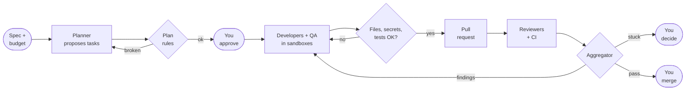
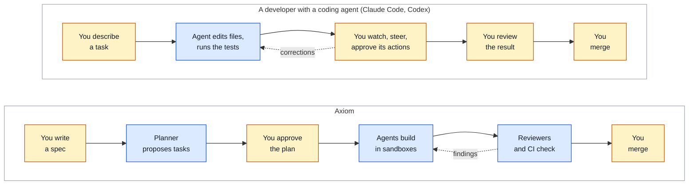
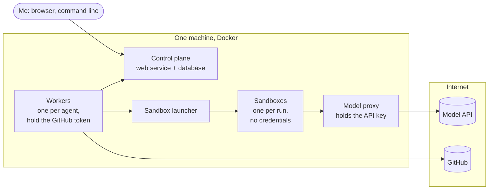
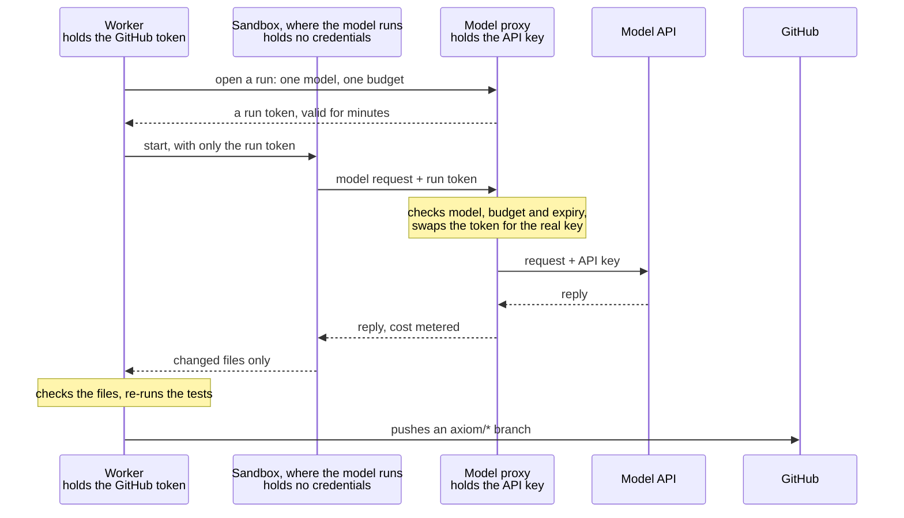

> **This is a learning project.** Axiom is not a product, not a service, and not ready for anyone's
> production code. I built it to understand, hands-on, what it takes to let AI coding agents do real
> work safely: who decides, who checks, what it costs, and where it breaks. Everything below is written
> in that spirit, including the parts that didn't work. The code and all its documentation are public:
> [github.com/bharathcmbox/axiom](https://github.com/bharathcmbox/axiom).

<!--more-->

## The problem

Coding agents are now good at a task you hand them in a session you're watching. You read what they do,
you correct them, you decide when it's done.

Things change when you want several agents to work on a real codebase without you approving every step:

- **Who decides what happens next?** If a model decides that work is finished, reviewed and ready to
  merge, a confident mistake goes straight through.
- **Who checks the work?** An agent reviewing its own work, or a twin of itself, isn't much of a check.
- **What does it cost?** A loop that retries "until it passes" can spend money without limit.
- **What can a misled agent reach?** An agent that reads a malicious comment in a repository shouldn't
  be able to hand your API keys to anyone.
- **Did it actually help?** Without measurements, "the agents did it" is an anecdote, not a result.

Axiom is my attempt to answer those questions in code: a control plane that runs a small team of
coding agents on a real repository, with me as the CTO. I started with code because it can be checked:
tests pass or fail, and a reviewer can point at a line. But the questions aren't specific to code, and my
longer-term goal is an architecture that can take on non-coding work too.

I built Axiom for under $25 in model API costs. Its test bed was [`tiny-agenticsoc`](https://github.com/bharathcmbox/tiny-agenticsoc), a small security-operations
project of mine that served as patient zero: every real task, review and drill in this post ran against it.

## What Axiom does

You give Axiom a specification. A planner agent reads the repository and proposes a set of tasks.
Plain code checks the plan, and you approve it. Developer and QA agents then implement the tasks in
locked-down sandboxes, in parallel where the work is independent. Two reviewer agents, running on a
different model, judge each change alongside your CI. Findings go back to the developer on the same
pull request. When everything passes, **you merge on GitHub. Axiom never merges.**

A few rules shaped everything:

1. **A model gives opinions; code makes decisions.** Every state change goes through hand-written
   state machines and one function that applies them. A reviewer's verdict is an input. The decision to
   approve, send back or escalate is made by a small, tested aggregator.
2. **Nobody approves their own work.** No agent can approve. Reviewers run read-only on a different
   model from the developers, and the system refuses a configuration that breaks this.
3. **Agents hold no credentials.** More on this below.
4. **Budgets stop work; they don't just report it.** Money is reserved before a run starts, per run,
   per task and per day.
5. **Everything is recorded.** All state lives in PostgreSQL, and every change writes an event to an
   append-only log in the same transaction. Killing the process loses nothing.

## How it differs from Claude Code and Codex

Claude Code and Codex are coding agents: you give one a task, and it edits files, runs commands and tests
itself, while you watch and steer. Axiom puts the same kind of agent inside an organization, and moves you from
inside the loop to its gates:

*Amber: you. Blue: AI.* With a coding agent, one agent does the work and you're its supervisor and its
reviewer, task by task, usually on your own machine with your own access. In Axiom, you appear at the gates
(the spec, the plan, the merge). Between them, work is split, done in parallel, and checked by other agents and
by plain code, in sandboxes that hold no credentials.

Axiom doesn't compete with coding agents; it uses one. Claude Code (through the Claude Agent SDK) does the
actual work inside Axiom's sandboxes. Claude Code and Codex are the *workers*. Axiom is an experiment in
the *organization* around them.

| | A coding agent (Claude Code, Codex) | Axiom |
|---|---|---|
| Unit of work | A task in a session | A specification, split into tasks with dependencies |
| Who drives | You, interactively | A backlog and state machines; you approve plans and merge |
| Who checks | You, as you go | Independent reviewers on another model, re-run tests, CI, then you |
| What decides "done" | You, or the agent | Plain code, from verdicts and CI on the exact commit reviewed |
| Credentials | Whatever the session can reach | None in the sandbox; separate services hold each secret |
| Cost control | Per session | Reserved before spending: per run, per task, per day |
| Record | The conversation | An append-only event log, with metrics computed from it |

The point isn't that coding agents lack these things. Many teams build them around agents in their own
way. The point was to build them myself, see which ones mattered, and measure them.

### What about Claude Managed Agents?

A fair question, since Anthropic now offers hosted agents. Conceptually, Axiom sits one layer above them.
Managed Agents runs an agent *session* for you: a hosted sandbox, credentials kept out of it and added on the
way out, spending caps, and a grader that checks the work against a rubric. Several of those are the same ideas I
built by hand in Axiom, which was reassuring to find.

Axiom is about the *organization* around many sessions: a backlog of tasks with dependencies, plans only a human
can approve, independent reviewers on a different model, plain code deciding what happens next, a human who
merges, and an event log across all of it. In Axiom's terms, Managed Agents is closest to the runtime layer, the
part that runs one agent safely, not to the control plane. (Managed Agents is still evolving, so I'm comparing
ideas here, not feature lists.)

## How the sandbox never sees a credential

This part taught me the most. To explain it, I need to introduce the pieces first.

### The pieces, and where they run

Everything in Axiom runs on one machine, as Docker containers started by Docker Compose. Only two things live
elsewhere, on the internet: the model API that the agents call, and GitHub, where the code is.

- **The control plane** is a small web service and a PostgreSQL database. It holds the backlog, the state
  machines and the event log, and it's what I talk to, from a browser or the command line.
- **A worker** is a long-running container, one per agent: two developers, a QA agent, a planner and two
  reviewers. A worker is ordinary, deterministic Python. It asks the control plane for work, prepares a copy
  of the repository, checks what comes back, and pushes to GitHub. It holds the GitHub token. It never runs
  the model itself.
- **A sandbox** is a short-lived container that a worker asks for, one per run. This is where the model
  actually works: Claude Code, reading and editing a copy of the repository. It is thrown away when the run
  ends.
- **The model proxy** is a small service that holds the model API key, and nothing else. Every model request
  from a sandbox goes through it.
- **A run token** is what a sandbox gets instead of a key: a random string that the proxy accepts for one
  model, up to one budget, for a few minutes.
- **The sandbox launcher** is the only service allowed to start containers. Workers ask it for a sandbox
  instead of holding that power themselves.

Containers sit on separate internal Docker networks with no route to the internet. Three small proxies are
the only way out, each for one purpose: one for the model API, one for GitHub (for workers only), and one for
package downloads (for sandboxes only).

### One run, step by step

The model runs in a sandbox that holds **no** credentials. Two things it needs are handled outside it:

- **The model API:** a small proxy is the only holder of the API key. The sandbox gets a short-lived run
  token that works for one model, under one budget, for a few minutes. The proxy swaps it for the real key
  on the way out, and meters what the run costs. That metered cost is the record. Whatever the sandbox
  claims, it isn't trusted.
- **GitHub:** the sandbox has no route to GitHub at all. A deterministic worker outside the sandbox holds
  the token. It checks the changed files (allowed paths, no secrets, no symlinks, tests passing on a clean
  copy) and only then pushes, to `axiom/*` branches only. There is no code path that merges.
- **Everything else:** because only the launcher can start containers, and the networks are internal, a
  misled model in a sandbox can reach the model proxy and the package proxy, and nothing else. Workers can't
  reach the database either: they go through the control plane's API like any other client.

## How I built it

I built Axiom in four phases, each ending with a demonstration on a real (small) repository of my own:

| Phase | What it added | How it was proven |
|---|---|---|
| 1. Control plane | Database schema, state machines, leases, event log, REST API | Every legal and illegal transition tested; killed mid-work and restarted with nothing lost |
| 2. First worker | Sandbox, worker, verification, pull requests, budgets | A real task went from "ready" to an open PR with no human input |
| 3. Quality | Independent reviewers, the aggregator, CI gate, rework on the same PR, GitHub sync | A planted one-character bug passed every test and CI; a reviewer caught it; an agent fixed it |
| 4. Engineering management | Planner and plan rules, QA agents, parallel developers, metrics, dashboard, hardening | A five-task specification planned, approved, built in parallel, reviewed and merged end to end |

The stack is deliberately plain: Python, FastAPI, PostgreSQL with raw SQL (no ORM), Docker Compose, and
pytest against a real database. I wrote it with Claude Code as a pair programmer, under a strict loop:
one small task at a time; code, tests and documentation together; lint and the full test suite before every
commit; one commit per task. Every transition needs a test for the legal path *and* a test proving that an
illegal attempt changes nothing and writes no event. The suite is now about 1,700 tests.

Documentation was part of every task, not an afterthought. [The guide](https://github.com/bharathcmbox/axiom/blob/main/docs/guide/README.md) has 16 chapters,
with diagrams checked by a parser in the test suite, a [scenario atlas](https://github.com/bharathcmbox/axiom/blob/main/docs/guide/13-scenarios.md) of every
situation a task can meet with the test that proves each one, and
[a chapter listing the mistakes](https://github.com/bharathcmbox/axiom/blob/main/docs/guide/14-how-it-was-built.md).

## What the real runs taught me

Unit tests caught logic errors. **Every expensive surprise came from real containers and real runs.** A few
examples:

- **A sandbox escape through git.** While preparing a prompt-injection drill, I found that a malicious
  `.git` directory left behind by the model could make the *harness's* git commands run code outside the
  sandbox (hooks, filters, an `fsmonitor` setting). The drill itself was refused at every step by the
  model. But the real hole was in my own plumbing. The fix: the harness never trusts the agent's `.git`, and
  uses its own sealed copy with an allowlisted environment.
- **A symlink that leaked an environment.** A file the sandbox left in its output folder could be a symlink
  to somewhere it shouldn't point. Now files from a sandbox are read only through a function that refuses
  links and non-regular files.
- **Budgets that starved a reviewer.** Reserving money before a run stopped two runs spending the same
  dollars. But the first reviewer could reserve almost everything, leaving the second too little to
  finish. It was then retried with even less each time. Fixes: a minimum below which a run waits rather
  than starts, no retry once a run is out of budget, and later a fair share of what's left for each
  waiting review.
- **Reviews are most of the cost.** Across real tasks, about three quarters of the spend went to the two
  reviewers.
- **The human is the bottleneck.** On the final run, agents took about three minutes per task. Each pull
  request then waited 13 to 27 minutes for me to read and merge it.

I also compared reviewer models on the same sixteen past reviews. A cheaper model (Claude Sonnet 5.5) caught
the planted bug and agreed with every verdict, at about a seventh of the cost of the stronger one (Claude
Fable 5.1). But it missed about half of the smaller findings, mostly about whether tests really test
anything. The stronger model, run twice, found mostly the same things both times, but once changed its
verdict by rating the same issue more severely. One run of one model isn't a measurement
([the full comparison](https://github.com/bharathcmbox/axiom/blob/main/docs/runs/2026-11-07-reviewer-comparison.md)).

**The numbers, for scale:** eight real tasks merged, about $1.40 per merged task all-in, 75% accepted on the
first review. The final five-task specification took 65 minutes from request to last merge, and cost $8.29.
The total API spend for building and proving all four phases was about $23. The final run is written up, step
by step, in [the run record](https://github.com/bharathcmbox/axiom/blob/main/docs/runs/2026-11-07-phase-4-exit-run.md).

## Limitations

This is where the "learning project" label earns its place:

- **The sample is tiny.** Eight tasks and one planted bug show that the loop works, not how well it works.
- **The main question is unanswered.** Does a team of agents beat one person driving one AI session? That
  needs hand-driven baselines on comparable work, and I haven't collected them yet.
- **One machine, one operator.** The API listens on localhost and isn't built for multiple users or for
  exposure to a network.
- **GitHub is still a way out.** A compromised agent can't reach my credentials. But its code does reach a
  branch, through the push the worker makes on its behalf. Reviews, CI and a human merge stand between that
  branch and `main`. On a free private repository, GitHub doesn't enforce that merge gate, so an early
  merge is possible (it's recorded and flagged).
- **One vendor.** Every agent runs on Claude models today. Cross-model review with a second runtime is still
  to come.
- **Small, well-scoped tasks only.** Everything so far has been changes of a few files. Larger or vaguer
  work is untested.

## What's next

The next phase is about scale and honesty:

- **A second runtime (Codex)**, so code written by one vendor's model is reviewed by another's.
- **A Managed Agents runtime**: keep Axiom's control plane, but replace my hand-built sandbox, credential
  proxy and budgets with Managed Agents sessions, stored credentials and session budgets. It's a good way to
  learn which parts are worth building yourself and which are better bought.
- **More developers in parallel**, and delivering the test repository's whole roadmap end to end.
- **Continuous operation**: running unattended on real work for weeks, not demos.
- **Baselines**: recording how long comparable tasks take by hand, so the metrics can finally answer
  whether this is worth it.
- **Cheaper reviews where they're good enough**: for example, a cheaper model for security review and the
  stronger one for code review, measured rather than assumed.
- **Beyond code.** Most of the architecture isn't about code: a plan you approve, work in sandboxes with no
  credentials, independent review, plain code deciding, budgets, a human at the gates, and an event log. Work
  such as research, analysis or documentation could go through the same loop. What doesn't carry over is the
  checking: today "done" means tests pass, CI is green and reviewers read a diff. Other kinds of work need
  their own ways to check a result, and finding those is the hard part.

## Closing

I set out to learn what an "AI engineering organization" actually needs. The models were the easy part.
The work was in everything around them: state machines that decide, reviewers that can't be talked into
approving, credentials an agent never sees, budgets that stop work before it's paid for, and an event log
that lets you check all of it afterwards.

If you build something similar, my one piece of advice is the pattern from the mistakes list: **run it for
real, early and small.** The tests told me the code was right. The real runs told me where it was wrong.

## Explore the code

Everything is on GitHub, under [bharathcmbox/axiom](https://github.com/bharathcmbox/axiom):

- [Executive summary](https://github.com/bharathcmbox/axiom/blob/main/docs/exec-summary.md): the one-page version of this post, with the numbers.
- [User guide](https://github.com/bharathcmbox/axiom/blob/main/docs/user-guide.md): how to work with Axiom day to day, from a specification to a merged
  pull request, and what to do when something comes to you.
- [Admin guide](https://github.com/bharathcmbox/axiom/blob/main/docs/admin-guide.md): installing and running it, credentials, models, budgets, and security
  operations.
- [The guide](https://github.com/bharathcmbox/axiom/blob/main/docs/guide/README.md): 16 chapters on how it's built, with diagrams.
- [Architecture decisions](https://github.com/bharathcmbox/axiom/tree/main/docs/decisions): why each choice was made.
- [Runs and drills](https://github.com/bharathcmbox/axiom/tree/main/docs/runs): the exit run and the reviewer comparison, and
  [the drills](https://github.com/bharathcmbox/axiom/tree/main/docs/drills), including the prompt-injection drill.
- [tiny-agenticsoc](https://github.com/bharathcmbox/tiny-agenticsoc): the project Axiom worked on, with every agent's pull request.

*Axiom is a personal learning project. Nothing here is a recommendation to run AI agents unattended on
code that matters.*
