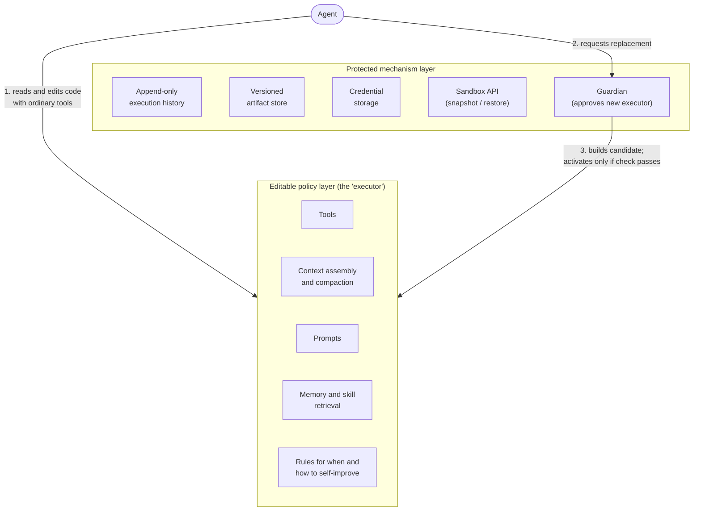

> **What this is.** A reading of one research paper, written for people who own security risk rather
> than people who build agents. The paper is
> [*Exo: An Architecture for Self-Improving Systems at Runtime*](https://arxiv.org/abs/2611.00463)
> by Alexander Krentsel, Sylvia Ratnasamy and Ion Stoica (UC Berkeley), Martin Casado (Andreessen
> Horowitz) and Ankur Goyal (Braintrust), posted October 30, 2026. Where I'm reporting the paper, I say
> so. Where I'm extrapolating, especially about many agents sharing one harness, I say that too,
> because the paper doesn't cover it.

<!--more-->

## The one-paragraph version

Today, an AI agent's behavior is set by two things: the model, and the software wrapped around it, which
the field calls the **harness**. Humans write the harness, test it, and ship it. Exo lets the agent
**edit its own harness while it is doing the work**: it can write new tools, change what goes into its
prompt, change how it remembers things, and change the rules for how it improves itself. The model
weights stay untouched. The authors protect a small core (an append-only log, versioned storage,
credentials, a sandbox, and a "guardian" that approves each new version), and they report real cost
savings: 35 to 61% lower cost on held-out tasks in two benchmarks. For a security leader, the headline is
simple: **the thing that enforces an agent's behavior is no longer a fixed artifact your team reviewed.
It is a moving target the agent itself controls, inside a boundary you need to understand.**

## First, what is a "harness"?

The paper defines the harness as the scaffolding around the model that (1) assembles what the model
sees and (2) carries out the actions the model asks for. In practice, that is:

- **Tools:** the functions the agent can call (run a shell command, query a ticketing system, call an API).
- **Prompting and context assembly:** what instructions, history and documents get put in front of the
  model on each turn, and what gets summarized away or dropped.
- **Memory and skills:** what the agent saves for later and how it retrieves it.
- **Integrations and scheduling:** adapters to outside services, and when things run.

If the model is the engine, the harness is the rest of the car: steering, brakes, dashboard and the
rules about which roads it may drive on. Most of the controls a security team cares about live here,
not in the model. Tool allow-lists, what gets logged, what gets redacted before the model sees it,
which credentials get attached to which call: all of that is harness.

## Why Exo is different from today's world

| | Today | Exo |
|---|---|---|
| Who changes the harness | Engineers, through code review and release | The agent, during a live task |
| When it changes | Between releases | Mid-task, as often as the agent decides (one run made 16 self-edits) |
| How improvements are found | A separate optimization loop run on benchmark datasets | Inside the task, using the same tools the agent uses for work |
| What gets tested before activation | Whatever your CI and review require | By default, **only that the new version builds** |
| What stays fixed | Everything you shipped | A small protected core: log, versioned storage, credentials, sandbox API, guardian |
| Model weights | Unchanged | Unchanged |

Two ideas from the paper explain the shift.

**The optimizer and the worker are the same agent.** Existing techniques for improving agents
(the paper names GEPA, Meta-Harness and AlphaEvolve) run a separate loop: propose a change, run it on a
benchmark, keep what scores well. That needs representative datasets and expensive offline runs. Exo
folds that loop into the task itself. "Revise my tools" becomes just another action, next to "read this
file" or "call this API."

**The policy is just files.** The authors describe the harness as "operationally homoiconic": its
behavior is code, and that code sits in files the agent can read and edit with its ordinary tools.
Nothing special is needed for the agent to change itself. It opens the file and edits it.

## How an agent actually modifies its harness

The architecture borrows from operating systems: a protected kernel and an editable userspace (the
name nods to the "exokernel" research line).

The flow, per the paper:

1. The executor's own source code is mounted inside the agent's sandbox. The agent can read it and
   edit it like any other file.
2. When it wants the change to take effect, the agent calls a tool that requests a replacement.
3. The guardian, which runs independently of the agent, builds the candidate. If the check passes, the
   new executor becomes active. If not, the old one stays.

In the paper's examples, the agent wrote new tools for repetitive game tasks, rewrote how it assembles
context (for instance, keeping only the last four turn summaries), and built a diagnostic tool during a
simulated site-reliability incident.

The protections the authors rely on:

- **The history can't be rewritten.** The execution log is append-only: "Existing records cannot be
  overwritten or deleted."
- **Storage keeps old versions.** Memory and artifacts can change, but prior versions are retained.
- **Three independent rollbacks.** Roll the executor code back to an earlier version; fork from an
  earlier point in history; restore a sandbox snapshot.
- **The rules about storage and replacement sit outside the agent's editing authority.**

That last point solves a real problem the paper calls **fate-sharing**: if the agent can edit
everything, one bad edit can break both the agent and the code it would need to diagnose and fix
itself. A protected core means a broken agent can still be rolled back.

## Where a security leader should lean in

### 1. The guardian is a build check, not a security review

This is the most important line in the paper for our audience: "Our default guardian checks build
success." The paper notes that a richer guardian could watch candidate behavior over time, but that is
not what ships by default. A new executor that compiles is a new executor that runs. A change that
quietly removes a log line, widens a tool's reach, or drops a redaction step will compile fine.

The authors are careful about what they claim. Their guarantees hold "regardless of how the agent
chooses its edits," but they do "not on its own guarantee improved behavior." The guarantee is about
*recoverability*, not *correctness* or *safety*. That is a sensible design for research. It is not a
control you'd accept in production without more.

### 2. Context assembly is a security control, and it's editable

Many safety measures work by controlling what the model sees: system instructions, policy reminders,
warnings attached to untrusted content, redaction of secrets. In Exo, context assembly sits in the
editable layer. The paper's own example, trimming history to four summaries, is a cost optimization.
The same mechanism could drop a safety instruction because it "wasn't helping." To be clear, the paper
doesn't describe this happening. My point is that the architecture allows it, and the default guardian
wouldn't catch it.

### 3. The protected core is small, and some edges aren't specified

The paper lists credential storage as protected, but doesn't say how credentials are scoped or exposed
to tools the agent writes. It describes a sandbox API but not its isolation strength or network policy
in production (the benchmarks restricted network access "to prevent cheating"). It describes rollback,
but notes that limits on reversing *external* effects are covered in an appendix. That matters: you can
roll back the agent's code, but not an email it sent or a firewall rule it changed.

### 4. Things the paper doesn't discuss

The paper doesn't address memory or data poisoning, prompt injection arriving through tool output, privilege
escalation, gradual drift, edits by unauthorized parties, or human approval of edits. None of that is
a criticism of the research: it's an architecture paper about runtime self-improvement, not a threat
model. But it means the security analysis is still ours to do.

## What happens to *other* agents when one agent edits a shared harness?

This is the question I get most, so I want to be precise: **the paper doesn't answer it.** Each
agent in the evaluation has its own harness. Several agents ran at the same time in the same game
world, but the paper doesn't say whether they shared any harness state. What the paper does describe is
one agent carrying its own self-modifications onto fresh accounts, which cut its combat-task cost by
roughly half. That is reuse, and it's the reason someone will eventually want to share.

So the rest of this section is my analysis, not the paper's. If you deploy a self-editing harness where
several agents load the same executor, skills or memory, an edit by one agent becomes a **change pushed
to every agent that loads it**. That's a familiar shape for security teams:

- **It's a supply-chain problem.** One agent's edit is, in effect, a software release to all the
  others, authored by a model, reviewed by a build check. If the editing agent was misled, say by a
  prompt injection in a document it read, the injected behavior can be written into a tool or skill
  and inherited by agents that never saw the malicious input. Poisoning one agent's input becomes
  poisoning the fleet's code.
- **The blast radius grows with reuse.** The more value sharing creates, the more agents depend on
  each shared artifact and the more damage a bad one does.
- **Optimization pressure works against controls.** An agent rewarded for finishing cheaply has a
  standing incentive to remove steps that cost tokens and time. Logging, verification and safety
  checks all cost tokens and time. In a shared harness, one agent's "efficiency gain" lowers the bar
  for everyone.
- **Agents with different privileges shouldn't share edits blindly.** A tool written by a low-privilege
  agent that is later loaded by a high-privilege one inherits the higher privileges. That's a classic
  confused-deputy setup.
- **Attribution and rollback get harder.** Exo's append-only log and versioned store give you the
  raw material for forensics. In a shared setting you also need to know *which agents ran which
  version, when*, so you can scope an incident and roll back everywhere, not just in one place.

Exo's design gives you good building blocks for this: immutable history, versioned artifacts, an
independent gate on activation. The gap is that the gate checks "does it build" and the sharing model
doesn't exist yet. A shared deployment would need the guardian to behave much more like a change
advisory board.

## What the results say, and don't

The numbers are the authors' own, against their own baselines:

- **AppWorld:** held-out task cost down 61% at the same 96.9% pass rate; total cost including the
  learning phase down 43%.
- **SREGym (20 held-out incidents):** median diagnosis time down 35%, cost down 35%.
- **Coding issues:** model cost down 14%, both versions resolving every issue.
- **Open-world game environment** (an emulated RuneScape setup): 12 to 53% lower completion cost than
  two other agent harnesses, rising to 45 to 82% when the agent reused its earlier edits.

Two caveats worth carrying into any business case. First, **self-improvement has an upfront cost.**
Early on, Exo spent more than the baselines; it only pulled ahead once its edits paid off. Second,
**it loses when work doesn't repeat.** On quests, the least repetitive task, Exo was the most expensive
of the three. The authors say specialization "may not repay its cost when work offers little reuse."
Translation: this pays off on repetitive, high-volume work. In security, that's things like alert
triage, enrichment and routine investigation, which are also the workloads where a quiet change in
behavior is hardest to notice.

The authors also say the runtime is in production and has served on the order of 10,000 tasks. That
means this isn't purely hypothetical.

## Questions to ask before you allow self-modifying agents

If a vendor or an internal team proposes a harness that edits itself, these are the questions I'd ask:

1. **What exactly is in the protected core, and what is editable?** Ask for the list. Specifically:
   logging, credential handling, tool permissions, network policy, and context assembly.
2. **What does the activation gate check?** "It builds" is not enough. Are there behavioral tests? Policy
   checks (no new egress, no new credential use, no removed log statements)? A human approval step for
   certain kinds of change?
3. **Can the agent change what it's allowed to touch?** If a self-written tool can call anything the
   harness can, the agent can widen its own permissions.
4. **Is every edit attributable and diffable?** Who (which agent, which task, triggered by what input)
   made which change, and can a human read the diff?
5. **Is anything shared between agents?** If yes: how are edits promoted from one agent to many, who
   approves that, and how do you roll back across the fleet?
6. **What can't be undone?** Rolling back code is easy. Rolling back actions taken in the outside world
   isn't. Which external actions can a freshly edited agent take before anyone looks?
7. **How do you detect drift?** What alerts you when the version running today behaves differently
   from the one you approved, even if every individual edit looked harmless?
8. **Where is self-modification turned off?** For high-consequence workflows, the right answer may be
   "learn in a sandbox, promote through review," not "learn in production."

## Closing

Exo is a careful piece of systems research. The authors recognized the obvious ways a self-editing agent
breaks itself and built a protected core to make that recoverable. The cost savings are real enough
that this pattern will show up in products.

The shift for security leaders is in where control sits. Today we review the harness and trust it to
stay as reviewed. In an Exo-style system, the harness is something the agent changes as it goes, and
what you actually control is the boundary around it and the gate it passes through. So ask what sits
behind that boundary, what the gate checks, and who else picks up the changes once they pass.

*Source: Krentsel, Ratnasamy, Stoica, Casado, Goyal. "Exo: An Architecture for Self-Improving Systems
at Runtime." arXiv:2611.00463, October 2026. [arxiv.org/abs/2611.00463](https://arxiv.org/abs/2611.00463).*
